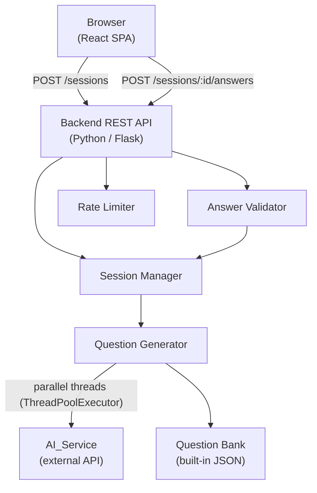

# Design Document

## Overview

FrankySense is a browser-based Halloween quiz game for beginner Python students. The player answers up to ten multiple-choice questions; each wrong answer advances Franky (a Frankenstein monster) one stage. Reaching Stage 5 ends the game. The player wins by finishing all ten questions with Franky at Stage 1–4 (at most three wrong answers).

The system has two independent tiers:

- **Backend** — a Python HTTP server that owns all game logic: session management, question generation, answer validation, rate limiting, and fallback to the built-in question bank.
- **Frontend** — a React/JavaScript single-page application that renders questions, Franky's current stage, and results, and communicates with the backend over a REST API.

The AI model API (AI_Service) is called exclusively by the backend and only during session creation. The frontend never talks to the AI_Service directly, and the backend never delegates answer grading to it.

---

## Architecture



### Key architectural decisions

| Decision | Choice | Rationale |
|---|---|---|
| Session storage | In-memory Python dict | No database needed; beginner-friendly; resets on restart which is acceptable for a game |
| Question generation | ThreadPoolExecutor (10 worker threads) with a 15 s batch timeout | Keeps Flask routes synchronous while still generating all 10 questions in parallel; avoids per-answer latency at question time (Requirement 1.3) |
| Rate limiting | In-memory counters keyed by IP + a daily global counter | Simple and dependency-free (Requirement 14.4) |
| IP detection | Werkzeug `ProxyFix(app, x_for=1)` | Flask's `request.remote_addr` returns the proxy IP without this; `x_for=1` trusts exactly one forwarding hop so the real visitor IP is used for rate limiting (Requirement 14.1) |
| AI grading | Never used | Backend stores the correct answer index at creation time and checks it in code (Requirement 3.2) |
| Fallback | Built-in JSON bank of ≥ 20 questions | Game remains playable when AI_Service is down (Requirement 12) |
| API key | `.env` file, read at startup | Never in source; server logs a warning and falls back to bank-only mode if key is absent (Requirement 9) |
| Static file serving | Flask serves the React `dist/` build in production | Single URL, no CORS needed in production; React dev server used separately in development |

---

## Components and Interfaces

### Backend file layout (one responsibility per file)

```
backend/
├── app.py               # Flask application factory, route registration
├── routes.py            # HTTP route handlers (thin; delegates to modules below)
├── session_manager.py   # Session CRUD and state machine; a threading.Lock guards all creates, lookups, deletes, and the Algorithm 4 idle cleanup of the sessions dictionary
├── question_generator.py# ThreadPoolExecutor-based parallel AI calls, timeout, dedup, bank substitution
├── answer_validator.py  # Correct/wrong determination; stage increment
├── rate_limiter.py      # Per-IP hourly counter, global daily counter; a threading.Lock guards all reads and writes of ip_hourly and global_daily
├── ai_client.py         # HTTP client wrapper for the AI_Service
├── question_bank.py     # Loads and exposes the built-in question bank
├── question_bank.json   # ≥ 20 hand-written questions
└── config.py            # Reads .env, exposes constants
```

### Frontend component layout (one responsibility per file)

```
frontend/src/
├── App.jsx              # Top-level router; holds session state
├── StartScreen.jsx      # "Start Game" button; shows a loading message ("Summoning Franky…" or similar) while POST /sessions is in-flight; transitions to QuestionCard once the session response arrives
├── QuestionCard.jsx     # Question text + four answer buttons
├── StitchedMonster.jsx  # Draws Franky as a composite SVG; overall size scales with franky_stage (stage 1 = tiny, stage 5 = huge) so size conveys the stage; each of the six topics (`variables`, `data_types`, `conditions`, `loops`, `functions`, `lists`) maps to a distinct SVG body part driven by missed_topics; a topic that appears more than once gets an extra stitch/glow on its existing part rather than a new part
├── FeedbackPanel.jsx    # Shows correct/wrong result and feedback text; always displays a Next button to advance to the next question. After the wrong answer that moves Franky to Stage 5, the button label is "Continue" and navigates to GameOverScreen. After the final question is answered and the session state is "win", the button label is "Continue" and navigates to VictoryScreen.
├── ScoreDisplay.jsx     # Correct answer count and wrong answer count
├── WeakSpotsSummary.jsx # Renders the end-of-game missed-topic summary used by both GameOverScreen.jsx and VictoryScreen.jsx; if missed_topics is empty on the victory screen, displays "Franky stayed tiny because there were no weak spots". Converts internal topic keys to human-readable display names before rendering (for example, `data_types` → "data types", `functions` → "functions").
├── GameOverScreen.jsx   # Final score + "Play Again" button (Game_Over path)
├── VictoryScreen.jsx    # Final score + "Play Again" button (Win path)
└── api.js               # Thin wrapper around fetch() for all backend calls
```

### REST API contract

All requests and responses use JSON. The backend sets CORS headers for the local dev origin.

#### `POST /sessions`

Creates a new session and returns the first question.

**Request body:** none

**Response `201`:**
```json
{
  "session_id": "uuid4-string",
  "question": {
    "index": 0,
    "text": "What keyword is used to define a variable in Python?",
    "options": ["var", "let", "No keyword needed", "dim"],
    "topic": "variables"
  },
  "franky_stage": 1,
  "correct_count": 0,
  "wrong_count": 0,
  "missed_topics": []
}
```

#### `POST /sessions/:session_id/answers`

Submits an answer for the current question.

**Request body:**
```json
{ "question_index": 0, "selected_option": 2 }
```

**Response `200` — answer accepted, session continues:**
```json
{
  "result": "correct",
  "feedback": "In Python you don't need a keyword — just write name = value.",
  "franky_stage": 1,
  "correct_count": 1,
  "wrong_count": 0,
  "missed_topics": [],
  "next_question": {
    "index": 1,
    "text": "...",
    "options": ["...", "...", "...", "..."],
    "topic": "data_types"
  }
}
```

**Response `200` — final question answered, game won:**
```json
{
  "result": "correct",
  "feedback": "...",
  "franky_stage": 3,
  "correct_count": 8,
  "wrong_count": 2,
  "missed_topics": ["loops", "functions"],
  "session_state": "win",
  "next_question": null
}
```

**Response `200` — wrong answer moves Franky to Stage 5:**
```json
{
  "result": "wrong",
  "feedback": "...",
  "franky_stage": 5,
  "correct_count": 6,
  "wrong_count": 4,
  "missed_topics": ["loops", "functions", "loops", "data_types"],
  "session_state": "game_over",
  "next_question": null
}
```

**Response `409`** — question already answered or session ended:
```json
{ "error": "question_already_answered" }
```
or
```json
{ "error": "session_ended", "session_state": "game_over" }
```

**Response `400` — selected_option is not an integer 0–3:**
```json
{ "error": "invalid_option" }
```

**Response `404` — session not found (expired or never created):**
```json
{ "error": "session_not_found" }
```

**Response `409` — answer submitted out of order:**
```json
{ "error": "out_of_order" }
```

---

## Data Models

> **Topic keys**: the six topics are represented internally as `variables`, `data_types`, `conditions`, `loops`, `functions`, `lists` in all API responses, `Question.topic`, `missed_topics` entries, the question bank JSON, and `StitchedMonster`'s body-part mapping. `WeakSpotsSummary.jsx` is the only place that converts these keys to display names.

### Session (server-side, stored in memory)

```python
@dataclass
class Session:
    session_id: str           # UUID4
    questions: list[Question] # Ordered list of 10 questions
    current_index: int        # Index of the next unanswered question (0–9)
    franky_stage: int         # 1–5; initialised to 1
    correct_count: int        # Correct answers submitted so far
    wrong_count: int          # Wrong answers submitted so far
    state: str                # "active" | "win" | "game_over"
    answered: set[int]        # Set of question indices already submitted
    missed_topics: list[str]  # Ordered list of topic strings for every wrong answer, in submission order
    last_activity: float      # Unix timestamp of the last request on this session; used for idle cleanup
    lock: threading.Lock      # Per-session mutex; prevents two simultaneous answer submissions
```

### Question (stored inside Session at creation time)

```python
@dataclass
class Question:
    index: int           # Position in the session (0–9)
    text: str            # Question prompt text
    options: list[str]   # Exactly four answer strings
    correct_index: int   # 0-based index into options
    feedback: str        # Explanation stored at creation; returned at answer time
    topic: str           # One of the six topic keys: variables, data_types, conditions, loops, functions, lists
    source: str          # "ai" | "bank"
```

The `correct_index` is **never** sent to the frontend. The frontend only receives `index`, `text`, `options`, and `topic`.

A module-level `threading.Lock` in `session_manager.py` is acquired for every create, lookup, delete, and idle-cleanup operation on the `sessions` dictionary. This is separate from the per-session `session.lock` used in Algorithm 2.

### RateLimitCounters (in-memory, module-level in `rate_limiter.py`)

```python
# Per-IP hourly AI session counter
# { ip_address: {"count": int, "window_start": float (unix timestamp)} }
ip_hourly: dict[str, dict]

# Global daily AI session counter
# {"count": int, "day": str (ISO date "YYYY-MM-DD")}
global_daily: dict
```

Counters reset automatically when the time window expires (checked on each request, no background thread needed).

A module-level `threading.Lock` in `rate_limiter.py` is acquired for every read and write of `ip_hourly` and `global_daily`, preventing race conditions when multiple requests arrive simultaneously.

### AI_Service prompt schema (sent by `ai_client.py`)

```json
{
  "topic": "loops",  // one of: variables, data_types, conditions, loops, functions, lists
  "difficulty": "beginner",
  "instruction": "Generate one multiple-choice Python quiz question. Return JSON with keys: text (string), options (array of exactly 4 strings), correct_index (0-based integer), feedback (string explaining why the correct answer is right)."
}
```

### AI_Service response schema (expected by `question_generator.py`)

```json
{
  "text": "...",
  "options": ["...", "...", "...", "..."],
  "correct_index": 2,
  "feedback": "..."
}
```

---

## Key Algorithms

### Algorithm 1 — Parallel question generation with timeout and dedup

```
Input:  10 topic slots (each slot has one assigned topic)
Output: list of 10 validated Question objects

1. Build the 10 topic slots:
   a. Start with one slot for each of the six topics (variables, data_types,
      conditions, loops, functions, lists) — this guarantees all six are covered.
   b. Fill the remaining four slots by sampling topics at random from the six,
      but cap any single topic at 3 slots total (one guaranteed + at most two
      random extras). This ensures the built-in bank, which has at least 3
      questions per topic, can always supply enough fallback questions.
   c. Shuffle the resulting 10-slot list so questions appear in random order.
   NOTE: for bank-only sessions, apply the same slot assignment so topic
   coverage is identical regardless of question source.

2. Submit all 10 slots to a ThreadPoolExecutor with 10 worker threads using
   executor.submit() — one future per slot. Each worker thread runs:
   a. Call AI_Service with the slot's topic using requests.post(..., timeout=10).
   b. Parse response; validate: len(options)==4 and correct_index in 0..3.
   c. If validation fails, make one more requests.post call (same slot, timeout=10).
   d. If the second call also fails, mark the slot as "needs bank fallback".
   e. If the AI call times out or raises an exception, mark the slot as
      "needs bank fallback".

3. Call concurrent.futures.wait(futures, timeout=15) to collect results.
   After the wait returns, call executor.shutdown(wait=False, cancel_futures=True)
   to discard any still-running threads without blocking.
   Any future that is not in the "done" set after the wait is marked
   "needs bank fallback"; its result is ignored even if it arrives later.

4. For every slot marked "needs bank fallback":
   a. Draw an unused question from the bank that matches the slot's topic.
   b. If no topic match is available, draw any unused bank question.

5. Deduplication pass:
   a. Collect all question texts.
   b. For any two questions with identical text, keep the first and replace
      the duplicate with an unused bank question of the SAME topic first;
      only if no same-topic bank question is available, draw from any unused
      bank question (Requirement 13.4).
   c. If dedup fails, proceed anyway (Requirement 13.5).

6. Return the final 10-question list.
```

### Algorithm 2 — Answer validation and stage update

```
Input:  session_id, question_index, selected_option
Output: result ("correct"|"wrong"), updated session state

Pre-lock validation:
0a. If selected_option is not an integer in the range 0–3 (inclusive),
    return 400 Bad Request with error "invalid_option".
0b. Look up Session by session_id. Return 404 if not found.

State update (inside a per-session threading.Lock):
1. Acquire session.lock.
2. If session.state != "active", return 409 (session_ended).
3. If question_index != session.current_index,
   return 409 with error "out_of_order".
   (If two requests arrive simultaneously, the second will see current_index
   already advanced and return "out_of_order" or "question_already_answered"
   — either is acceptable as long as session state is unchanged.)
4. If question_index in session.answered, return 409 (question_already_answered).
5. Mark question_index as answered (session.answered.add(question_index)).
6. question = session.questions[question_index]
7. result = "correct" if selected_option == question.correct_index else "wrong"
8. If result == "correct":  session.correct_count += 1
9. If result == "wrong":    session.wrong_count += 1
                             session.franky_stage += 1
                             session.missed_topics.append(question.topic)
10. If session.franky_stage >= 5:  session.state = "game_over"
    Else if question_index == 9:   session.state = "win"
    Else:                           session.current_index += 1
11. session.last_activity = now()   # updated inside the lock
12. Release session.lock.
13. feedback = question.feedback if question.feedback else DEFAULT_FEEDBACK
14. Return result, feedback, updated stage/counts, missed_topics, next question (or null).
```

*(All state mutations above happen inside the session lock — atomicity guarantee per Requirement 10.2.)*

### Algorithm 3 — Rate limiting check

```
Input:  ip_address
Output: "ai_allowed" | "bank_only"

0. If no AI_Service API key is configured (bank-only mode):
   return "bank_only" immediately without reading or writing any counter.

1. Reset global_daily counter if current date != global_daily["day"].
2. If global_daily["count"] >= 200: return "bank_only".

3. entry = ip_hourly.get(ip_address)
4. If entry exists and (now - entry["window_start"]) >= 3600:
       delete entry  # window expired
5. entry = ip_hourly.get(ip_address)
6. If entry exists and entry["count"] >= 5: return "bank_only".

7. # Allow AI usage; increment counters
   global_daily["count"] += 1
   if entry exists: entry["count"] += 1
   else:            ip_hourly[ip_address] = {"count": 1, "window_start": now}
8. return "ai_allowed"
```

The rate limiter reads `request.remote_addr`, which is set to the real visitor IP by `ProxyFix(app, x_for=1)` registered in `app.py`.

### Algorithm 4 — Session cleanup (idle-session reaping)

```
Input:  the in-memory sessions dict
Output: sessions dict with idle sessions removed

Called at the start of every POST /sessions handler (no background thread needed).

1. current_time = now (unix timestamp)
2. For each session_id, session in list(sessions.items()):
   a. If (current_time - session.last_activity) > 3600 seconds (1 hour):
      delete sessions[session_id]

NOTE: session.last_activity is updated to now() on every answer submission
(step 11 of Algorithm 2 (inside the lock)) and at session creation.
```

---

## Correctness Properties

*A property is a characteristic or behavior that should hold true across all valid executions of a system — essentially, a formal statement about what the system should do. Properties serve as the bridge between human-readable specifications and machine-verifiable correctness guarantees.*

### Property 1: Answer validation never delegates to AI

*For any* session and any submitted answer, the result returned by the backend ("correct" or "wrong") is determined solely by comparing `selected_option` to the stored `correct_index` — the AI_Service is never called during answer submission.

**Validates: Requirements 3.1, 3.2**

### Property 2: Franky stage increments only on wrong answers

*For any* session and any sequence of answer submissions, Franky's stage after N wrong answers equals `1 + N`, and correct answers leave the stage unchanged.

**Validates: Requirements 4.1, 4.4**

### Property 3: Franky stage is bounded at 5

*For any* session, Franky's stage is always in the range [1, 5], regardless of how many wrong answers are submitted.

**Validates: Requirements 4.1, 5.1**

### Property 4: Session terminates at Stage 5

*For any* session, the first wrong answer that would bring Franky to Stage 5 also sets `session.state = "game_over"`, and no further answer submissions are accepted.

**Validates: Requirements 5.1, 10.4**

### Property 5: Win condition requires all questions answered before Stage 5

*For any* session where the player answers all 10 questions and Franky's stage never reaches 5, the final session state is "win"; if Franky reaches Stage 5 at any point, the state is "game_over" regardless of the question index.

**Validates: Requirements 6.1, 5.1**

### Property 6: No duplicate questions per session

*For any* generated session, every question in the 10-question list has a distinct `text` value.

**Validates: Requirements 13.1, 13.4**

### Property 7: Question serialization round-trip

*For any* question generated by the AI_Service, parsing the AI response and re-serializing the resulting `Question` object produces equivalent `text`, `options`, `correct_index`, and `feedback` values.

**Validates: Requirements 8.4**

### Property 8: Every session covers all six topics

*For any* session of 10 questions, the set of `topic` values across all questions contains all six Python topics (variables, data_types, conditions, loops, functions, lists).

**Validates: Requirements 7.1, 7.2**

### Property 9: Rate limiting caps AI session counts correctly

*For any* sequence of session creation requests from a single IP address, once that IP has created 5 AI-powered sessions within a rolling 60-minute window, all subsequent requests within the same window use the Question_Bank instead of the AI_Service.

**Validates: Requirements 14.1, 14.2**

### Property 10: Already-answered questions are rejected

*For any* active session, submitting an answer for a question index that has already been answered returns a 409 error and leaves the session state unchanged.

**Validates: Requirements 10.3**

### Property 11: Feedback fallback is always non-empty

*For any* answer submission where the stored feedback for the question is empty or missing, the response feedback field contains a non-empty default fallback string.

**Validates: Requirements 3.5**

### Property 12: missed_topics mirrors Wrong_Answer topics in order

*For any* session, `session.missed_topics` has the same length as `wrong_count`, and each entry at index i equals the topic of the i-th question the player answered wrongly, in submission order.

**Validates: Requirements 15.1, 15.4**

---

## Error Handling

| Scenario | Backend behaviour | Frontend behaviour |
|---|---|---|
| AI_Service call times out (> 10 s) | Treat as unavailable; substitute bank question | Transparent to player; session starts normally |
| AI response fails validation twice | Substitute bank question for that slot | Transparent to player |
| API key absent at startup | Log warning to stderr; start in bank-only mode | No visible change; game is playable |
| `.env` file absent at startup | Same as missing key above | No visible change |
| `selected_option` out of range 0–3 | Return `400 Bad Request` with error `"invalid_option"` before acquiring the session lock | FeedbackPanel shows generic error message |
| `question_index != session.current_index` | Return `409` with `out_of_order` | Frontend shows generic error; player stays on current question |
| Answer submitted for ended session | Return `409` with `session_ended` | Frontend shows appropriate screen (Game_Over or Victory) |
| Duplicate question detected post-generation | Replace with unused bank question; if bank exhausted, proceed (Requirement 13.5) | Transparent |
| Bank has fewer than needed questions of a topic | Fall back to any unused bank question | Transparent |
| `question_already_answered` (duplicate submission) | Return `409` with `question_already_answered` | Frontend stays on the current question; no state change |
| Session not found (404) | Return `404 Not Found` | Frontend shows "your game expired — returning to start screen" and navigates back to StartScreen |

---

## Deployment

- Flask serves the production React build from its static file directory, so
  the game is served from a single URL with no separate frontend server.
- Because sessions and rate-limit counters live in memory, the server MUST run
  as a single worker process (e.g. `gunicorn --workers 1 --threads 8`). One process keeps all in-memory sessions and counters shared; `--threads 8` lets Gunicorn handle up to 8 concurrent requests within that single process, so the game stays responsive while question generation threads are running.
- During local development, run the React dev server separately and configure
  Flask CORS headers for the local dev origin only. Remove CORS headers for
  production.
- Build step: `npm run build` in the frontend directory; copy or symlink the
  `dist/` output to `backend/static/`.

---

## Testing Strategy

### Unit tests (example-based)

Focused on specific, concrete scenarios:

- `answer_validator.py`: correct answer returns "correct" and does not increment `wrong_count`; wrong answer increments `franky_stage` by 1; fourth wrong answer sets `state = "game_over"`.
- `rate_limiter.py`: 5th request within an hour is allowed; 6th is denied; counter resets after the hour window; daily counter resets at midnight.
- `question_generator.py`: slot that times out is replaced with a bank question; slot that fails validation twice is replaced with a bank question; dedup removes identical question texts.
- `question_bank.py`: bank loads at least 20 questions; each topic has at least 3 entries; each entry has exactly 4 options and a valid `correct_index`.
- `session_manager.py`: new session starts at Stage 1 with zero counts; answering an already-answered question returns 409.
- `answer_validator.py` (missed_topics): submitting a wrong answer appends its topic to `missed_topics`; submitting a correct answer leaves `missed_topics` unchanged; a topic that is missed more than once appears multiple times in the list in submission order.

### Property-based tests

Using **[Hypothesis](https://hypothesis.readthedocs.io/)** (Python property-based testing library), minimum 100 iterations per property.

Each test references its design property in a comment:
`# Feature: frankysense-game, Property N: <property_text>`

| Property | Test strategy |
|---|---|
| Property 1: Answer validation never delegates to AI | Generate random sessions with random correct indices; assert AI client is never called during `validate_answer` |
| Property 2: Franky stage increments only on wrong answers | Generate random sequences of correct/wrong submissions; assert `franky_stage == 1 + wrong_count` throughout |
| Property 3: Franky stage is bounded at 5 | Generate sessions with any number of wrong submissions; assert `1 <= franky_stage <= 5` always |
| Property 4: Session terminates at Stage 5 | Generate sessions driven to Stage 5; assert state is "game_over" and further submissions return 409 |
| Property 5: Win condition | Generate full 10-question sessions with varying wrong counts; assert state is "win" iff `wrong_count <= 3` at end |
| Property 6: No duplicate questions | Generate batches of questions using the generator with mocked AI; assert all `text` values are unique |
| Property 7: Question serialization round-trip | Generate random AI response dicts; assert parse → serialize produces identical fields |
| Property 8: Every session covers all six topics | Generate sessions with mocked AI responses; assert topic set equals the full six-topic set |
| Property 9: Rate limiting caps correctly | Generate random sequences of requests from a single IP; assert AI is used for at most 5 within any 60-minute window |
| Property 10: Already-answered questions are rejected | Generate sessions; submit same question index twice; assert second submission returns 409 and state is unchanged |
| Property 11: Feedback fallback is non-empty | Generate questions with empty/None feedback; assert response feedback is non-empty string |
| Property 12: missed_topics mirrors Wrong_Answer topics in order | Generate random sequences of correct and wrong answer submissions; assert `len(missed_topics) == wrong_count` and `missed_topics[i]` equals the topic of the i-th wrong answer submitted |

### Integration tests

- Full session lifecycle: POST `/sessions` → submit 10 answers → verify final state.
- Bank-only mode: start server with no API key; verify game is playable with bank questions only.
- CORS headers present on all routes during local development (not in production where Flask serves the React build from the same origin).
- Stage 5 path: submit 4 wrong answers; verify `session_state = "game_over"` on the 4th.
